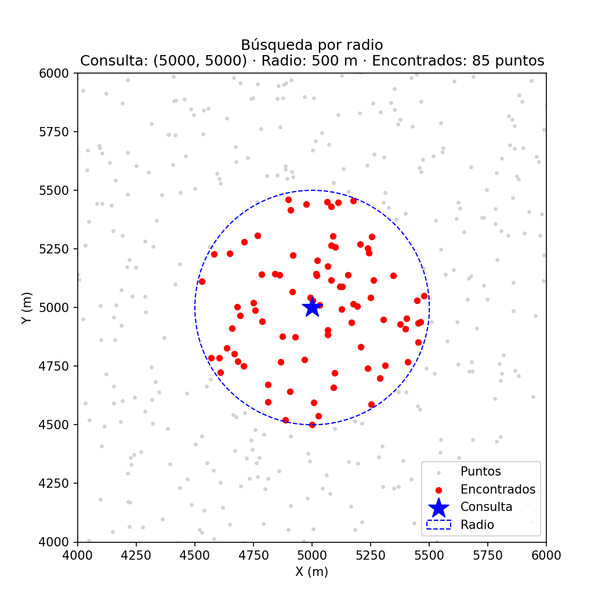
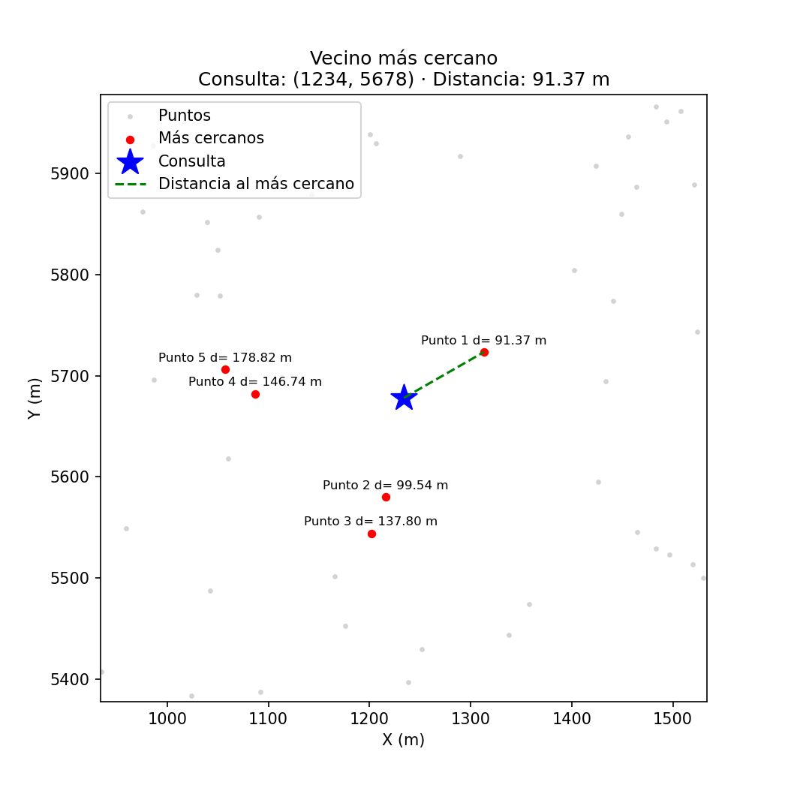
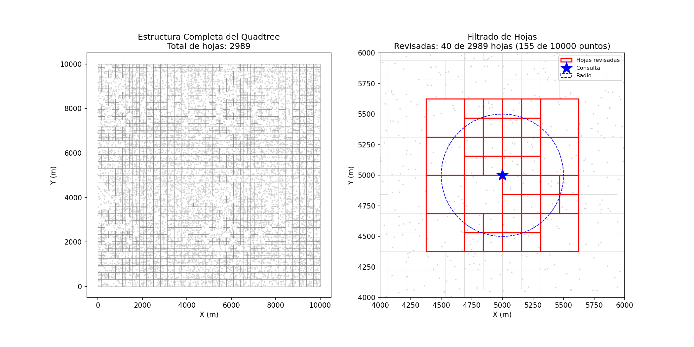
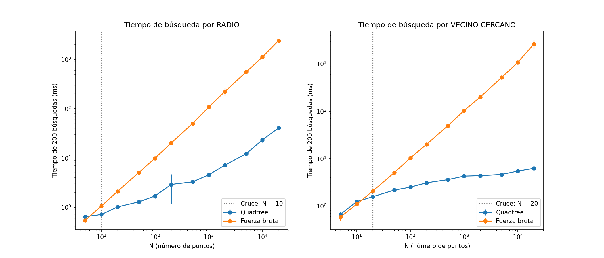

# Laboratorio 4: Quadtree para puntos de entrega

**Estudiante:** Karelyn Caicedo Velez

## 1. Problema
Un equipo, del cual soy parte, desarrolla un sistema de logística de entregas en una ciudad y tenemos 10.000 puntos de entrega repartidos por la ciudad, y necesitamos responder rápido dos preguntas: *"¿qué puntos de entrega están a un radio de 500 m de un punto dado?"* (búsqueda por radio) y *"¿cuál es el punto de entrega más cercano a una ubicación dada?"* (vecino más cercano). Entonces para responderlas implementé un Quadtree para K-dimensiones, y lo comparé contra la solución de fuerza bruta, que revisa todos los puntos uno por uno.

Este laboratorio lo implementé en lenguaje de programación Python.

## 2. Estructura del repositorio
| Archivo | Qué contiene |
|---|---|
| `Quadtreetree.py` | Implementación: `generar_puntos`, `distancia`, clase `Nodo` (insertar, dividir, `distancia_a_caja`, `buscar_radio`, `vecino_cercano`), clase `Quadtree` y las dos funciones de fuerza bruta. |
| `test.py` | 7 pruebas unitarias con `unittest` y las funciones que generan las gráficas 1, 2 y 3. |
| `analisis.py` | Experimento de rendimiento: mide construcción y búsquedas para varios N, imprime la tabla, calcula el punto de cruce y genera la gráfica 4. |
| `graficas/` | Las 4 imágenes generadas (`1_busqueda_radio.png`, `2_vecinos_cercanos.png`, `3_estructura_quadtree.png`, `4_rendimiento.png`). |
| `README.md` | Este informe. |

## 3. Cómo ejecutar
Se debe tener una versión Python 3.10 o superior (lo probé con Python 3.14.5) y matplotlib.

```bash
pip install matplotlib
python test.py       # genera las gráficas 1-3 en graficas/ y corre las 7 pruebas (≈ 3 s)
python analisis.py   # mide los tiempos, imprime la tabla y genera la gráfica 4 (≈ 50 s)
```

`analisis.py` tarda casi un minuto porque la fuerza bruta con N = 20.000 hace 200 consultas × 20.000 distancias, y todo se repite 5 veces.

## 4. Diseño del Quadtree
- **Unidades:** el mapa es un cuadrado de 10.000 × 10.000 m (una ciudad de 10 km de lado) y el radio de búsqueda está en metros (500 m). Usé metros para que las coordenadas, las distancias y el radio estén en la misma unidad y los resultados tengan sentido físico.
- **K dimensiones:** cada nodo es una caja definida por una lista de `minimos` y `maximos` (K números cada una), y al dividirse tiene 2^K hijos (4 en 2D, 8 en 3D). El número del hijo se arma con un bit por dimensión: el bit `d` vale 1 si el punto está en la mitad superior de esa dimensión (`punto[d] >= centro[d]`). En 2D queda así:

  | Punto | ¿x ≥ 5.000? (bit 0)	| ¿y ≥ 5.000? (bit 1)	| Hijo = bit0·1 + bit1·2 |
  |---|---|---|---|
  |(2.000, 3.000)	| no → 0	| no → 0	| 0 (abajo-izquierda) |
  |(7.000, 1.000)	| sí → 1	| no → 0	| 1 (abajo-derecha) |
  |(4.000, 8.000)	| no → 0	| sí → 1	| 2 (arriba-izquierda) |
  |(9.000, 6.000)	| sí → 1	| sí → 1	| 3 (arriba-derecha) |

  La misma lógica (`indice |= 1 << d`) sirve para cualquier K sin cambiar el código.
- **Capacidad 8:** cada hoja guarda hasta 8 puntos. Cuando llega el noveno, el nodo se divide en 2^K hijos, reparte sus puntos entre ellos y queda vacío (solo los nodos hoja guardan puntos).
- **Tamaño mínimo 1 m:** si muchos puntos son idénticos (o casi), dividir nunca los separa y el árbol se dividiría infinitamente (recursión infinita). Por eso, si la caja ya mide ≤ 1 m en todas las dimensiones, el nodo deja de dividirse y acepta más de 8 puntos.
- **Semilla 2026:** `generar_puntos` usa `random.Random(2026)` para que los mismos puntos salgan en cada ejecución; así las pruebas y las gráficas son reproducibles.

## 5. Algoritmos de búsqueda
- **Búsqueda por radio:** `distancia_a_caja` calcula la distancia mínima entre el punto de consulta y la caja de un nodo (0 si el punto está dentro). Si esa distancia es mayor que el radio, la caja no toca el círculo y se descarta el nodo con todos sus hijos. Si es hoja, se revisa cada punto; si no, se baja a los hijos.
- **Vecino más cercano:** se guarda el mejor punto encontrado hasta ahora y su distancia (empieza en infinito). En cada nodo interno los hijos se ordenan por `distancia_a_caja` y se visita primero el más cercano, así se encuentra un buen candidato pronto. Cualquier caja cuya distancia sea mayor o igual que la del mejor actual se descarta, porque ningún punto dentro de ella puede ser más cercano.
- **Fuerza bruta:** recorre la lista completa y calcula la distancia a todos los puntos. Siempre es O(N) por consulta y fue la referencia para comparar.

## 6. Pruebas unitarias
| # | Prueba | Qué verifica |
|---|---|---|
| 1 | `todos_los_puntos_quedan_guardados` | Al insertar 10.000 puntos, las hojas suman exactamente 10.000 (no se pierde ni se duplica ninguno). |
| 2 | `la_raiz_se_divide` | Con 10.000 puntos la raíz tiene hijos y no guarda puntos propios. |
| 3 | `radio_igual_a_fuerza_bruta` | En 100 consultas con radio 500 m, el Quadtree devuelve los mismos puntos que la fuerza bruta. |
| 4 | `vecino_igual_a_fuerza_bruta` | En 100 consultas, el vecino más cercano y su distancia coinciden con la fuerza bruta. |
| 5 | `funciona_en_3d` | Con K = 3, radio y vecino coinciden con la fuerza bruta (el código generalizado funciona). |
| 6 | `puntos_repetidos` | 20 puntos idénticos se guardan sin recursión infinita y la búsqueda con radio 0 los encuentra todos. |
| 7 | `arbol_vacio` | Un árbol sin puntos devuelve `(None, inf)` en vez de fallar. |

**Resultado:** `Ran 7 tests ... OK` (7/7).

La prueba 2 fue importante: cuando tuve un error en la condición de `caja_minima`, el árbol nunca se dividía y guardaba todo en la raíz. Las pruebas 1, 3 y 4 seguían pasando, porque una sola hoja con todos los puntos da los mismos resultados que la fuerza bruta (simplemente es igual de lenta). Solo la prueba 2 detecta que el árbol no se está construyendo de verdad.

## 7. Visualizaciones
Búsqueda por radio de 500 m desde (5000, 5000): en rojo los 85 puntos encontrados dentro del círculo.



Vecino más cercano desde (1234, 5678): la línea verde va al más cercano (a 91,37 m) y se marcan los 5 puntos más cercanos con su distancia.



Izquierda: las 2.989 hojas del Quadtree (las cajas son más pequeñas donde hay más puntos). Derecha: para la búsqueda de radio 500 m solo se revisan 40 hojas (155 de 10.000 puntos); el resto se descarta sin calcular distancias.



## 8. Análisis de rendimiento
### 8.1 Metodología
- **Tamaños:** N = 5, 10, 20, 50, 100, 200, 500, 1.000, 2.000, 5.000, 10.000 y 20.000. Empecé desde N = 5 porque quería encontrar el punto exacto donde el Quadtree empieza a ganar; si empezaba en 1.000 solo vería que gana, pero no desde cuándo.
- **Consultas:** M = 200 puntos de consulta aleatorios por medición, radio de 500 m.
- **Repeticiones:** 5 por cada N, cada una con puntos distintos (semilla `1000·rep + n`); reporto media ± desviación estándar.
- **Medición:** `time.perf_counter()` alrededor del bloque completo de 200 consultas (no de cada consulta por separado, porque una sola es demasiado rápida para medirla bien). La construcción del árbol se mide aparte.
- **Equipo:** Intel Core i7-1255U (12.ª generación), 16 GB de RAM, Windows 11 Home, Python 3.14.5.

### 8.2 Resultados
Tiempos en ms para 200 consultas (media ± desviación estándar de 5 repeticiones):

| N | Construir | Árbol radio | FB radio | Árbol vecino | FB vecino |
|---:|---:|---:|---:|---:|---:|
| 5 | 0,007 ± 0,003 | 0,64 ± 0,06 | **0,54** ± 0,01 | 0,66 ± 0,08 | **0,58** ± 0,09 |
| 10 | 0,022 ± 0,006 | **0,71** ± 0,03 | 1,05 ± 0,02 | 1,23 ± 0,05 | **1,09** ± 0,04 |
| 20 | 0,025 ± 0,001 | **1,01** ± 0,04 | 2,09 ± 0,01 | **1,57** ± 0,06 | 2,05 ± 0,04 |
| 100 | 0,19 ± 0,07 | **1,69** ± 0,17 | 9,89 ± 0,24 | **2,48** ± 0,17 | 10,33 ± 0,74 |
| 1.000 | 2,43 ± 0,15 | **4,52** ± 0,21 | 107,54 ± 8,71 | **4,25** ± 0,28 | 102,86 ± 6,32 |
| 10.000 | 41,41 ± 6,19 | **23,21** ± 2,56 | 1.107,09 ± 60,48 | **5,43** ± 0,44 | 1.070,57 ± 68,78 |
| 20.000 | 81,43 ± 2,60 | **40,49** ± 1,22 | 2.396,38 ± 66,65 | **6,23** ± 0,21 | 2.616,85 ± 571,81 |

(En negrita el más rápido. La tabla completa con los 12 tamaños la imprime `analisis.py`.)



### 8.3 Respuesta: ¿desde qué tamaño gana el Quadtree?
- **Búsqueda por radio:** el Quadtree es más rápido desde **N = 10** y sigue ganando en todos los tamaños mayores.
- **Vecino más cercano:** el Quadtree es más rápido desde **N = 20**.

Con N = 10.000, que es el caso del problema, el Quadtree es unas 48 veces más rápido en radio y unas 200 veces más rápido en vecino más cercano.

## 9. Discusión
1. **¿Por qué el cruce está tan abajo?** Con capacidad 8, un árbol de 5 puntos es una sola hoja: el Quadtree hace lo mismo que la fuerza bruta más el costo extra de `distancia_a_caja` y las llamadas recursivas, por eso pierde. Apenas N pasa de 8 la raíz se divide, y desde ahí ya puede descartar cajas enteras. Como cada distancia en Python es costosa, ahorrarse unas pocas ya compensa el trabajo extra, y por eso el cruce ocurre en N = 10–20 y no en miles. El vecino cruza un poco después porque además ordena los hijos en cada nodo.
2. **¿Por qué la búsqueda por radio crece más que la de vecino?** El radio es fijo (500 m), así que la cantidad de puntos dentro del círculo crece proporcional a N (con 10.000 puntos son ~80 en promedio; con 20.000 serían ~160) y todos hay que devolverlos. El vecino más cercano siempre devuelve un solo punto y, mientras más denso el mapa, más rápido encuentra un buen candidato y más cajas descarta, así que crece casi como log N (de 4,3 ms a 6,2 ms entre N = 1.000 y 20.000).
3. **Costo de construcción:** con N = 10.000 construir el árbol tarda ~41 ms. Cada consulta de fuerza bruta cuesta ~5,4 ms y con el árbol cuesta ~0,03–0,12 ms, así que se ahorran ~5,3 ms por consulta: la construcción se paga sola en menos de 10 consultas. Como los puntos de entrega son datos estáticos y no cambian a cada rato, el árbol se construye una vez y se reutiliza para miles de consultas, así que vale totalmente la pena.

## 10. Limitaciones
- Los puntos son aleatorios uniformes; una ciudad real tiene zonas muy densas (centro) y zonas vacías, lo que daría un árbol más desbalanceado y otros tiempos.
- Los tiempos dependen del computador, de lo que estuviera corriendo al mismo tiempo y de Python. En otro equipo o en otro lenguaje los valores absolutos cambian, aunque la tendencia debería ser la misma. Se nota en algunas desviaciones grandes, como FB vecino con N = 20.000.
- Las mediciones de tiempo se hicieron solo en 2D. En 3D solo comprobé que los resultados sean correctos (prueba 5), no la velocidad.
- El árbol no permite borrar ni mover puntos; si los datos cambiaran seguido habría que reconstruirlo.

## 11. Uso de inteligencia artificial
Usé IA, específicamente Claude, Gemini y el autocompletado de GitHub Copilot en Visual Studio Code como apoyo para entender conceptos (cómo generalizar el Quadtree a K dimensiones con bits, cómo funciona la poda en el vecino más cercano), para revisar errores cuando algo no funcionaba (por ejemplo, el problema de `caja_minima` y la recursión con puntos repetidos), para tener esqueletos de los códigos y de las gráficas con matplotlib, y para ayudarme a organizar y redactar este README a partir de mis resultados. 

Yo escribí y corregí el código. Claude me daba esqueletos para guiarme y yo los completaba. También aceptaba las sugerencias de GitHub Copilot cuando eran correctas y coincidían con lo que iba a escribir. Cuando no sabía cómo hacer una parte, buscaba ejemplos en Google, y si después de varias páginas seguía sin entenderlo, me guiaba por los ejemplos que sugería Gemini. También escribí y corrí las pruebas, ejecuté el análisis de rendimiento en mi computador e interpreté los resultados para la discusión.
